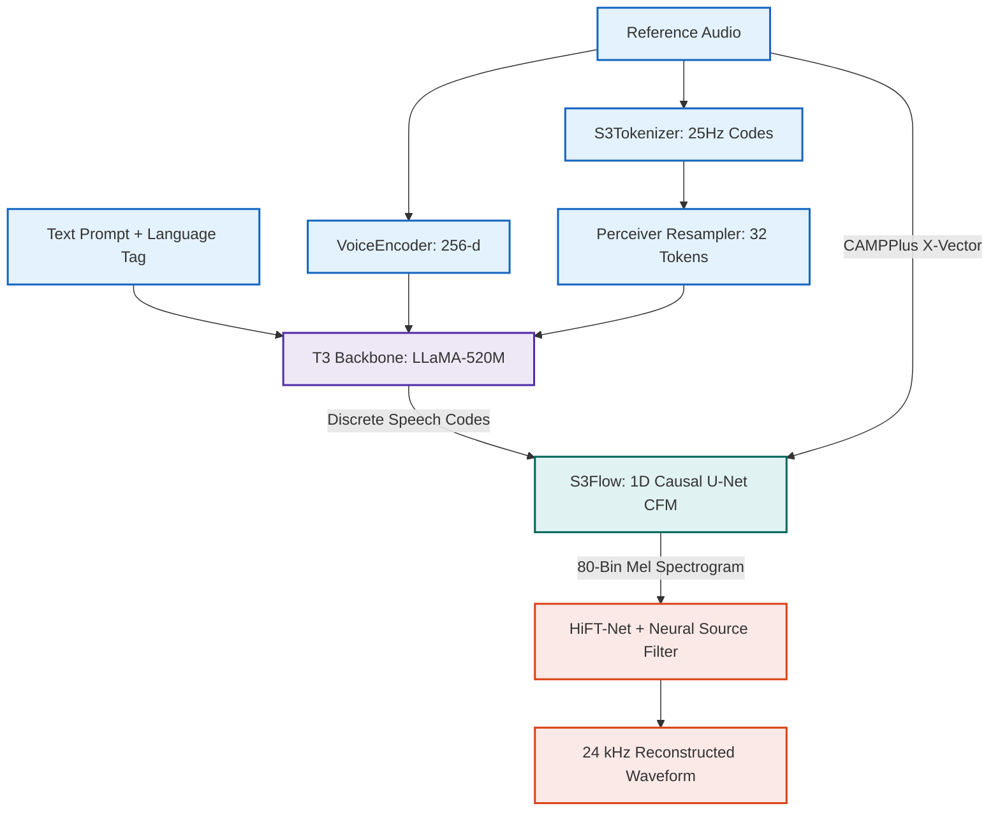

# Chatterbox V3 Multilingual — PyTorch Implementation

A modular, dependency-light PyTorch clean-room implementation of Resemble AI's **Chatterbox V3** zero-shot multilingual text-to-speech and voice cloning engine.

---

## 🧠 Architectural Overview

Chatterbox decomposes zero-shot speech synthesis into two synchronized stages: an **autoregressive language brain (T3)** that models discrete phonetic timing, and a **continuous flow matching synthesizer (S3Gen)** that renders acoustic timbre into high-fidelity 24 kHz waveforms.



- **Detailed Tensor Flow**: See [`assets/detailed_diagram.mmd`](./assets/detailed_diagram.mmd)
- **High-Level Flow**: See [`assets/high_overview_diagram.mmd`](./assets/high_overview_diagram.mmd)

---

## ⚙️ Mathematical Highlights

1. **Classifier-Free Guidance (CFG) Interpolation**:
   $$\mathbf{l}_{\text{guided}} = \mathbf{l}_{\text{cond}} + s \cdot (\mathbf{l}_{\text{cond}} - \mathbf{l}_{\text{uncond}})$$
   Where $s = 0.0$ disables accent transfer for cross-lingual synthesis.

2. **Continuous Flow Matching (CFM) Velocity Field**:
   Transforms random noise $\mathbf{x}_0 \sim \mathcal{N}(0, \mathbf{I})$ into clean mel representations $\mathbf{x}_1$ using Euler ODE stepping:
   $$\mathbf{x}_{t + \Delta t} = \mathbf{x}_t + \Delta t \cdot \left[(1 + \gamma) \mathbf{v}_\theta(\mathbf{x}_t, t, \mathbf{c}) - \gamma \mathbf{v}_\theta(\mathbf{x}_t, t, \emptyset)\right]$$

3. **Neural Source Filter (NSF) Periodic Harmonic Excitation**:
   $$s(t) = \sum_{h=1}^H \sin\left(2\pi \sum_{\tau=0}^t \frac{h \cdot F_0(\tau)}{f_s} + \phi_h\right) \cdot \mathbb{I}(F_0 > 0) + \epsilon$$

---

## 🚀 Quickstart

Run the interactive Zero-Shot Studio:

```bash
python -m Zoo.serve_voice_clone
```

Or synthesize directly via Python API:

```python
from Zoo.Chatterbox.Chatterbox import ChatterboxModel

model, processor = ChatterboxModel.from_pretrained(device="cuda")

inputs = processor(
    text="Hello world! This is Chatterbox running inside the unified Model Zoo.",
    reference_audio="path/to/reference_voice.wav",
    language="en",
    device=model.device,
)

wav = model.generate(
    text_tokens=inputs["text_tokens"],
    ref_24k=inputs["ref_24k"],
    ref_16k=inputs["ref_16k"],
)
```
