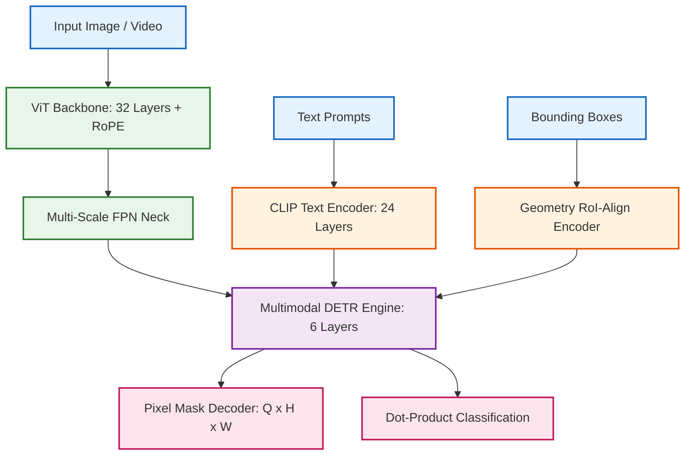

# SAM3 — Clean-Room PyTorch Implementation

A modular, dependency-light PyTorch implementation of **SAM3** (Segment Anything Model 3) with zero-shot open-vocabulary object detection, pixel segmentation, and video temporal tracking.

---

## 🧠 Architectural Overview

SAM3 couples a large-scale Vision Transformer with a Feature Pyramid Network (FPN), a text prompt encoder, geometric RoI-Align box decoders, and a multimodal Deformable DETR core.



- **Detailed Tensor Flow**: See [`assets/detailed_diagram.mmd`](./assets/detailed_diagram.mmd)
- **High-Level Flow**: See [`assets/high_overview_diagram.mmd`](./assets/high_overview_diagram.mmd)

---

## ⚙️ Key Technical Features

1. **Relative Position Bias (RPB)**:
   $$\Delta_{x,\text{log}} = \text{sign}(8\Delta_x) \cdot \frac{\log_2(8|\Delta_x| + 1)}{\log_2(8)}$$
   Supplies query-to-pixel relative spatial biases directly within cross-attention layers.
2. **FlashAttention Acceleration**: Powered by native `F.scaled_dot_product_attention` across both DETR attention blocks and ViT window blocks.
3. **Weight Compatibility**: State dictionaries match official checkpoints (`facebook/sam3`) with 100% key and tensor alignment.
4. **Streaming Shard Loading**: Leverages `Zoo.Common.model_loader` for CPU-RAM-safe shard-by-shard loading into `bfloat16`/`float16`.
5. **Video Temporal Tracking**: Integrated `Sam3TrackerModel` with memory attention enables mask propagation across video sequences.

---

## 🚀 Quickstart

```bash
python Zoo/serve_sam3.py
```
