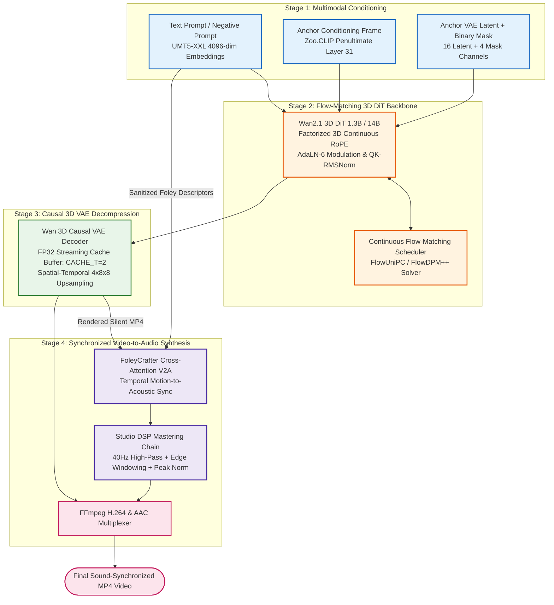

# Wan2.1: Continuous Flow-Matching Video Foundation Models

A modular, clean-room PyTorch implementation of Alibaba Cloud's **Wan2.1** Video Generation Suite (`Wan-AI/Wan2.1-T2V-1.3B`, `Wan2.1-T2V-14B`, and `Wan2.1-I2V-14B-720P`). It unifies text-to-video (T2V), image-to-video (I2V), and first-and-last-frame conditioning (FLF2V) with **FoleyCrafter video-to-audio cross-modal synthesis**.

---

## 🧠 System Architecture



- **Detailed Tensor Flow**: See [`assets/detailed_diagram.mmd`](./assets/detailed_diagram.mmd)
- **High-Level Flow Diagram**: See [`assets/high_overview_diagram.mmd`](./assets/high_overview_diagram.mmd)

---

## ⚡ Architectural Deep Dive

### 1. Continuous Flow Matching & Time-Shifted Velocity Trajectories

Wan2.1 models video generation as a continuous Probability Flow Ordinary Differential Equation (ODE):
$$\frac{\mathrm{d}x_t}{\mathrm{d}t} = v_\theta(x_t, t, c)$$
Where $x_1 \sim \mathcal{N}(0, \mathbf{I})$ represents pure Gaussian noise and $x_0$ represents the pristine clean latent.

To allocate more sampling budget to high-frequency visual details without increasing step counts, Wan2.1 applies a **time-shifted noise schedule**:
$$\sigma(s) = \frac{S \cdot s}{1 + (S - 1) \cdot s}, \quad s \in [0, 1]$$
Where $S = 3.0$ for 480P generation and $S = 5.0$ for 720P generation.

### 2. Factorized 3D Continuous Rotary Position Embeddings (RoPE)

Unlike 1D text RoPE, Wan2.1 factorizes attention query and key rotations across three distinct physical dimensions: **Temporal/Frame ($F$)**, **Height ($H$)**, and **Width ($W$)**:
$$\mathbf{R}_{F, H, W} = \mathbf{R}_F \otimes \mathbf{R}_H \otimes \mathbf{R}_W$$
The head dimension $D$ is split into:
$$D = d_t + d_h + d_w, \quad d_h = d_w = 2 \left\lfloor \frac{D}{6} \right\rfloor, \quad d_t = D - 2d_h$$
Frequencies are generated in the complex polar domain:
$$\Theta_k = \frac{1}{\theta^{2k / d}}, \quad \mathbf{z} = \cos(p \Theta) + i \sin(p \Theta)$$
This permits variable frame lengths and non-square resolutions without spatial distortion.

### 3. Streaming Causal 3D Conv VAE with Temporal State Buffering

The WanVAE compresses spatial-temporal video volumes by $4 \times 8 \times 8$:
$$\text{Video: } (3, F, H, W) \xrightarrow{\text{Encode}} \text{Latent: } \left(16, \left\lfloor\frac{F-1}{4}\right\rfloor + 1, \frac{H}{8}, \frac{W}{8}\right)$$
To avoid out-of-memory errors on long videos, the convolutional decoder operates **causally** with a temporal cache size of $\text{CACHE\_T}=2$:

- The first frame is decoded independently.
- Subsequent frames attend only to the past $2$ temporal frames stored in the streaming feature buffer.
- **FP32 execution is strictly enforced** to prevent black-frame NaN blowups caused by float16 underflow in causal residual normalization.

---

## 🚀 Quickstart

### 1. Launch the Unified Video Studio (Gradio UI & API)

Run the dedicated server with on-demand VRAM management:

```bash
python -m Zoo.Wan21.server_create_video
```

### 2. Programmatic Python Execution via Unified `Wan21`

```python
from Zoo.Wan21.Wan21 import Wan21

# Initialize unified pipeline (1.3B or 14B, T2V or I2V)
wan = Wan21.from_pretrained(
    task="t2v",
    scale="1.3B",
    resolution="480P",
    offload_model=True,  # Keeps models in CPU RAM until needed
)

# Generate video with motion-synchronized Foley audio
video_path = wan.generate(
    prompt="A cinematic drone shot of a futuristic cyberpunk city in torrential rain, neon reflections.",
    steps=20,
    guide_scale=5.0,
    enable_audio=True,
)
print(f"Generated video with sound saved to: {video_path}")
```
